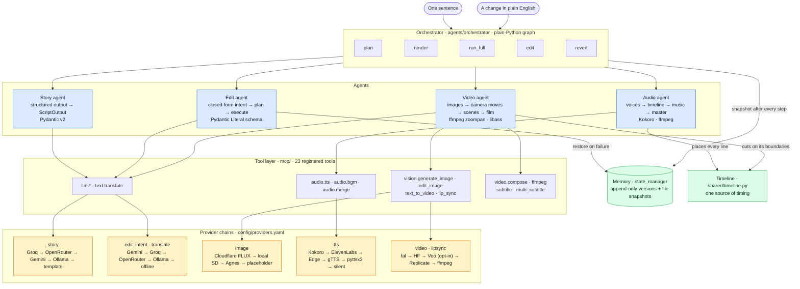
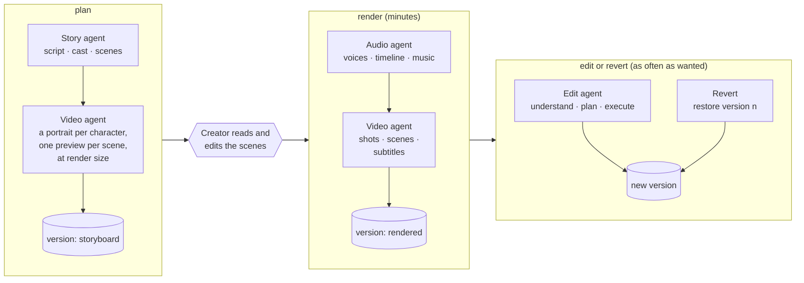
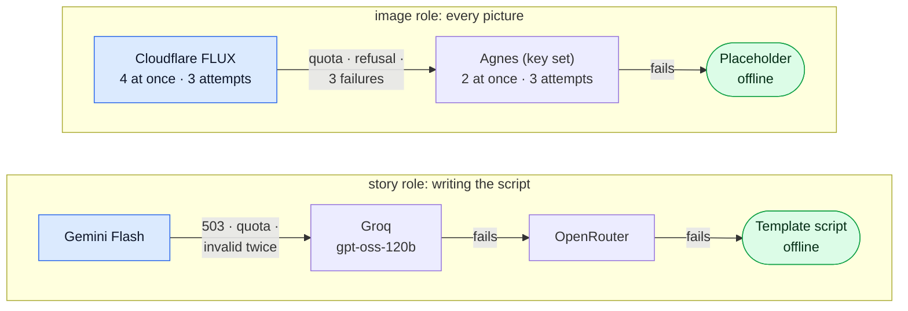
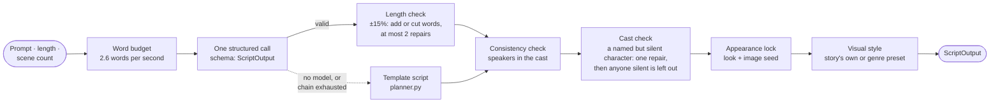
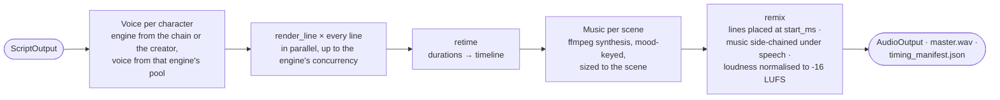
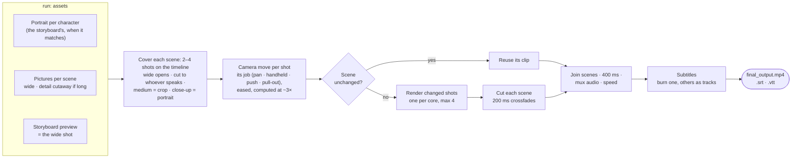
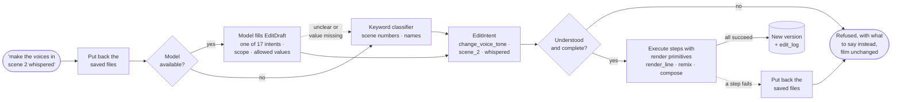
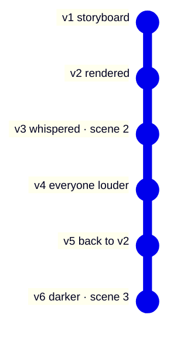

# Agentic architecture

Four agents, one orchestrator, a tool layer, and provider chains, designed so
that every model call is **structured, validated, replaceable and allowed to
fail**. The system around them (processes, queue, database, deployment) is in
[ARCHITECTURE.md](ARCHITECTURE.md).

- [1. The map](#1-the-map)
- [2. Design principles](#2-design-principles)
- [3. Orchestration](#3-orchestration)
- [4. Provider chains](#4-provider-chains)
- [5. Story agent](#5-story-agent)
- [6. Audio agent](#6-audio-agent)
- [7. Video agent](#7-video-agent)
- [8. The timeline](#8-the-timeline)
- [9. Edit agent](#9-edit-agent)
- [10. Memory: versions and undo](#10-memory-versions-and-undo)
- [11. The tool layer](#11-the-tool-layer)

---

## 1. The map

Every box names the framework or model doing the work.

---

## 2. Design principles

| Principle | What it means in the code |
|---|---|
| **Agents never name a model** | An agent asks for a *role* (`story`, `image`, `tts` …) and gets that role's chain from `config/providers.yaml`. Swapping Gemini for Claude, or adding a paid image model, is a YAML edit. |
| **Every model answer is a schema** | The script is a `ScriptOutput`, an edit is an `EditDraft`: Pydantic models sent to the provider as a native JSON schema where it supports one, validated on the way back. Malformed JSON is retried once with the validation error fed back to the model. |
| **Closed vocabularies where actions follow** | The edit model chooses from enumerated intents and values the executor can actually perform. An invented intent fails validation instead of becoming a silent no-op. |
| **Fail loudly, fall back visibly** | A provider that fails returns `success=False` or raises; the chain moves on and logs which provider served each result. Nothing ships degraded under a success label. |
| **Always an offline path** | A deterministic template script, a keyword edit classifier, placeholder images, silent audio of the right length. The whole test suite runs this way, with no keys. |
| **Human in the loop at the cheap moment** | The storyboard (script, a portrait per character and one image per scene) is reviewed and edited before the expensive render. |
| **Edits reuse the render's primitives** | An edited film is built by the same `render_line → retime → remix → compose` steps as a new one, so the two cannot drift apart. |
| **Every step is undoable** | The orchestrator snapshots state and files after each step; "go back" is itself a new version. |

Why a plain-Python graph rather than LangGraph or CrewAI is decision
[ADR-002](DECISIONS.md#adr-002-a-plain-python-orchestrator-not-langgraph).

---

## 3. Orchestration

`PipelineOrchestrator` (`agents/orchestrator/workflow.py`) exposes five
operations. Each runs as a job on a worker, emits progress events, and ends in
a snapshot. `plan` and `render` are the product's normal path; `run_full` does
both without stopping (the CLI's default).

The graph is a small node executor (`agents/orchestrator/graph.py`): each node
is an agent step; `on_node` and `on_node_done` callbacks turn into progress
events; an exception stops the graph and becomes an `error` event. Between
nodes is also where a cancelled job stops, never inside an ffmpeg call.

---

## 4. Provider chains

`shared/providers.py` reads `config/providers.yaml` and returns, for a role,
the providers whose credentials are present, in order. Tools walk that list.

How a provider hands over:

- **Permanent errors** (HTTP 400, 401, 403) move to the next provider at once.
- **A used-up daily quota** (a 429 whose message names a daily window) moves to
  the next provider at once too, and is named on the job's completion event
  (`daily_quota_used_up`) and on its trace (DST-20).
- **Short-term rate limits and 5xx** retry with back-off where the provider has
  `retries:`. The free image endpoints get three attempts. A timeout is never
  retried. A language model that is down is skipped immediately; the next one
  is faster than waiting.
- **A malformed structured answer** is retried once with the validation error
  added to the prompt.
- **Nothing counts until it validates:** an image must decode, JSON must match
  its schema, audio must not be empty.
- **Each provider has its own concurrency slot** (a semaphore), so a fallback
  that takes one request at a time is never flooded.

| Role | Chain (first available wins) | Offline end |
|---|---|---|
| `story` | Groq gpt-oss-120b → OpenRouter → Gemini Flash → Ollama (Groq first since DST-15; see [EVAL.md](EVAL.md)) | deterministic template |
| `edit_intent` | Gemini → Groq gpt-oss-20b → OpenRouter → Ollama | regex + keyword classifier |
| `translate` | Gemini → Groq → OpenRouter → Ollama → MyMemory | skip that language |
| `image` | Cloudflare Workers AI FLUX.1-schnell → local Stable Diffusion → SD WebUI → Agnes → OpenAI | placeholder image |
| `tts` | Kokoro (local, onnxruntime) → ElevenLabs → Edge TTS → gTTS → pyttsx3 | silence of the right length |
| `video` | fal → Hugging Face → Veo 3.1 (needs `VIDEO_BUDGET_OK`) → Replicate | ffmpeg camera moves |
| `lipsync` | fal → Replicate | a heuristic mouth animation on the portrait |
| `music` | ffmpeg synthesis | none |

Details that came from running it, not from theory:

- **Reasoning models answer nothing at small token caps** (they spend the
  budget thinking), so every call has a 600-token floor.
- **Free endpoints rate-limit per IP.** Measured (when Pollinations was still in the chain): keyless Pollinations answers
  one request at a time and returns 429 to the rest. The pool was once sized
  from the first provider's limit, so a fall-back from Cloudflare sent four
  requests at once and the run came back full of placeholders, hence a
  semaphore per provider.
- **A paid provider never becomes the default by being better.** Free
  providers come first; Veo needs a second, deliberate opt-in on top of a key.

---

## 5. Story agent

`agents/story_agent/`. One sentence in, a validated `ScriptOutput` out: the
story (title, logline, genre, visual style), the cast (with voice traits and a
visual description), and scenes (setting, tone, visual prompt, lines).

- **Length is a budget, then a check.** The prompt states how many words fit
  in total and per scene (`shared/timeline.py` `word_budget`). The speaking
  rate, 2.6 words/second, is Kokoro's, measured from 39 real lines (DST-28;
  2.2 was edge-tts's, from M3). After the script comes back, its planned length
  is computed with the timeline's own estimate; outside ±15% it goes back to
  the model once or twice ("add or cut about N words", same cast and scenes),
  the closest script wins, and a script still outside is flagged on the plan's
  completion event and in the storyboard (`length` in the storyboard answer).
  The offline template budgets by the same estimate and is never repaired.
- **The cast is sized to the film, and only speakers stay (DST-33).** A character
  is on screen only through their lines, so a listed character with none was
  drawn and voiced for nothing. The prompt asks for a cast of 2 up to a limit from
  the film's length (`shared/timeline.py` `cast_limit`: the lines the film has room
  for, 1.5 per character, between 2 and 4: 2 for a 15 s film, 3 for 20 s, 4 from
  30 s), allows fewer only for a deliberately single-voice story, says every
  character must speak, and says characters the creator names in their own prompt
  must be in the cast and speak. (The floor matters: a first wording that only
  capped the cast and asked for "the characters this story needs" made 6 of 25
  live films a monologue; see `docs/EVAL.md`.) After the script comes back
  (`agents/story_agent/cast.py`):
  1. A silent character whose name is in the creator's prompt is worth one more
     model call (`SCRIPT_CAST_REPAIRS`). The answer is used only if the cast and
     scenes are unchanged, nobody who spoke is silenced, fewer named characters are
     silent and the length is not pushed outside the tolerance.
  2. Anyone still silent, whatever their role, is removed from the cast before
     appearances are locked, voices assigned, portraits drawn or any file is
     written, so the cast row, the image budget and the scene chips all follow.
     A script where nobody speaks is left as it is, so the cast is never empty.
     The names and whether each was named in the prompt are in
     `state.metadata["cast_check"]`.
  3. The creator is told only when someone they named was removed: a sentence under
     the cast row (`cast_note` in the plan stream and the storyboard answer, and in
     the completion note). Removing a character the writer invented says nothing.
  A length repair that silences someone who spoke is discarded, and the offline
  template follows the same rule (its synopsis names only people who speak).
  Known limit: a scene's picture is drawn from the scene text, so it can still
  show a character who is not in the cast.
- **Characters keep their faces.** The appearance lock tops up each
  description with stable details the writer left vague and fixes a seed, so
  a character looks the same in every shot and after a re-render.
- **The look is the story's.** A horror short and a children's fable get
  different visual styles, and the wrong look goes into the negative prompt.

---

## 6. Audio agent

`agents/audio_agent/`. The script in, an `AudioOutput` and the film's
**timeline** out. Its three steps are public because edits reuse them.

- **Music ducks under dialogue** (`sidechaincompress`, measured ~6 dB while a
  line plays, recovering over the next second), so the bed can sit louder in
  the gaps.
- **Scene-only voices** (`AudioOutput.scene_voices`): "whisper in scene 2"
  stores an override for that scene, so a later "make everyone louder" makes
  scene 2 a louder whisper rather than undoing it.

---

## 7. Video agent

`agents/video_agent/`. Assets first, then composition. `compose` is also
what every edit calls.

- **Frame-exact.** Each clip is rendered to an exact frame count, with extra
  frames to cover its crossfade, so crossfades never shorten the film and the
  final frame count equals the timeline's.
- **Smooth pans on stills.** `zoompan` positions its crop at whole pixels;
  computing the move at 3× and scaling down turns that into a fraction of an
  output pixel. Measured by phase correlation: up to 5.13 px/frame of travel
  with a worst frame-to-frame jump of 0.19 px.
- **A scene is covered, not just shown (DST-36).** `coverage.plan_coverage` cuts each
  scene into 2 to 4 shots: a wide shot that pans opens it, the film cuts to whoever
  is speaking (shot and reverse shot) with a shot for each line while the cap of 4
  allows, and the last shot pulls out. A close-up is the speaker's own portrait, a
  medium is a crop of the scene's wide picture, so extra shots cost no extra
  image; only a scene of 14 s or more draws one more picture, a detail to cut away
  to. Dialogue gets a slow handheld sway, and a slow push-in when the moment is
  heavy (the scene's tone, or a line that shouts, trails off or breaks off). The
  storyboard and the render call the same planner, so the storyboard's shot strip
  is what the render cuts. Cuts are absolute milliseconds on the shared timeline,
  so frame-exact sync is unchanged. Every number is in `config/video.yaml`.
  A scene with a real lip-sync or text-to-video clip keeps the earlier plan.
- **Sharp pictures (DST-35).** Films are 1080p. Pictures stay at 1280x720 (storing
  them at 1080p cost 1.85x the disk for no extra detail) and are enlarged once,
  with Lanczos, to well above the output size before the camera moves; moves
  ease in and out; one light unsharp mask runs per shot; the earlier encodes are
  CRF 18 and only the last one, the delivered file, is CRF 20 (medium, High,
  yuv420p, faststart). Every number and the reason for it is in
  `config/video.yaml` (read by `shared/video_quality.py`); the measurements are
  in `docs/EVAL.md`. A picture holds about 1024 px of real detail, so this stops
  the pipeline from losing detail; it cannot add any.
- **Shots run side by side.** A shot keeps about one core busy (zoompan is
  single-threaded), so shots of every changed scene share one pool: on the
  2-core server a 43 s film went from 6 min 38 s to 4 min 52 s.
- **Subtitles are real text in every script.** Fonts are chosen per language
  and checked to cover it; a test burns each script and counts hollow
  "missing glyph" boxes.

---

## 8. The timeline

The single source of timing. Audio places lines on it, video cuts on its
boundaries, subtitles read its numbers. This is the start of a real film from
the server:

```mermaid
gantt
    title One timeline drives sound, picture and subtitles (seconds)
    dateFormat x
    axisFormat %S
    section Sound
    pre-roll, no speech          : 0, 1500
    line 1                       : 1500, 6662
    line 2                       : 6912, 9792
    scene 1 tail                 : 9792, 10392
    scene 2 pre-roll             : 10392, 11892
    line 3                       : 11892, 15625
    section Picture
    establishing wide            : 0, 1500
    shot for line 1              : 1500, 6912
    shot for line 2              : 6912, 10392
    scene 2 establishing         : 10392, 11892
    shot for line 3              : 11892, 15625
    section Subtitles
    line 1                       : 1500, 6662
    line 2                       : 6912, 9792
    line 3                       : 11892, 15625
```

Every cut lands on a line's start. Boundaries are converted to frames from
**absolute** milliseconds (never by adding rounded durations), so rounding
error cannot accumulate: before this existed, the voice led the picture by
2.4 s in scene 1 and 6.1 s by scene 4.

---

## 9. Edit agent

`agents/edit_agent/`. A sentence in, a new version or an honest refusal out.

The 17 edits it can make, by what they change:

| Target | Edits |
|---|---|
| Audio | `change_voice_tone` · `change_voice` · `adjust_volume` · `add_background_music` · `remove_background_music` · `regenerate_audio` |
| Picture | `apply_filter` · `adjust_scene_aesthetic` · `regenerate_scene` · `change_character_design` |
| Film | `remove_subtitles` · `add_subtitles` · `speed_up` · `slow_down` · `recompose_video` |
| Script | `regenerate_script` · `change_genre` |

Why the closed form exists: with free-form JSON, a live model classified
"make the voices in scene 2 whispered" as an invented intent with an invented
parameter; the planner fell back to re-recording, and the film came back
identical, reported as success. Measured after the change against both live
models: every real phrasing mapped correctly (including "the recipe scene
should feel darker" → scene 2 by its title), and "make it better" came back
as *unclear* and was refused.

---

## 10. Memory: versions and undo

The agents' memory is the version history. Every plan, storyboard edit,
render, edit and revert appends a version with the full state and a copy of
every file it refers to.

History is linear: going back to v2 creates v5 with v2's state and files, so
v3 and v4 remain reachable. Measured: the revert's film is byte-identical to
v2's.

---

## 11. The tool layer

`mcp/` is an internal tool registry (not the Model Context Protocol). Tools
register on import; agents call
`ToolExecutor().execute("audio.tts", ...)` and get a
`ToolResult(success, data, error, metadata)`, where `metadata` records which
provider actually served the call. `safe_run` turns exceptions into failures,
so one tool's crash is a result the agent can act on.

| Category | Tools |
|---|---|
| LLM | `llm.text_generate` · `llm.json_structure` · `text.translate` |
| Audio | `audio.tts` · `audio.bgm` · `audio.merge` |
| Vision | `vision.generate_image` · `vision.edit_image` · `vision.style_transfer` · `vision.text_to_video` · `vision.lip_sync` |
| Video | `video.compose` · `video.ffmpeg` · `video.image_to_clip` · `video.subtitle` · `video.multi_subtitle` |
| System | `system.file_read` · `system.file_write` · `system.file_delete` · `system.log` · `system.state_snapshot` · `system.state_revert` · `system.state_history` |

Adding a provider is a `_provider_<name>` method (images) or an adapter in
`mcp/tools/llm_tools/llm_client.py` (models), plus an entry in
`config/providers.yaml`, never an `if os.getenv(...)` in an agent.
