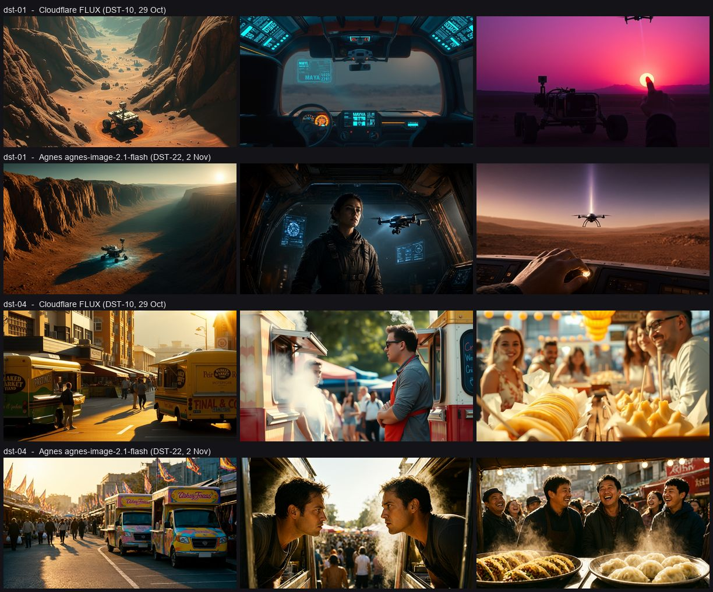

# Evaluation: baseline quality on the test set

DST-10 baseline, measured on the **Gemini-first** story chain, and the DST-15
comparison with the **Groq-first** chain (run G). Every number below comes
from a run listed in this file, on the date given. Raw results are in `data/benchmarks/` (not committed; `data/`
is ignored). Results from different commits or different provider conditions
are reported separately and never averaged together.

## Runs

| Run | Raw file(s) | When (PKT) | Code | What ran | Images | Scripts, translation | Voices |
|---|---|---|---|---|---|---|---|
| **P1** | `20261029_022957_testset.json` | 2026-10-29 02:29 | `2823ce3` + the `--plan-only` flag (uncommitted) | plan only, dst-01 to dst-05 | forced placeholder | chain Gemini → Groq → OpenRouter | none |
| **P2** | `20261029_024354_testset.json` | 2026-10-29 02:43 | same | plan only, dst-04 (rerun after outage) | forced placeholder | same | none |
| **P3** | `20261029_094803_testset.json` | 2026-10-29 09:48 | same | plan only, dst-05 to dst-25 | forced placeholder | same | none |
| **R** | `20261029_102217_testset.json` … `20261029_104625_testset.json` (one per film) | 2026-10-29 10:22 to 10:49 | same | full render, the 8 subset films, one at a time, 90 s apart | real chain: Cloudflare → Pollinations → placeholder | same chain; Gemini out of quota, so all Groq | Kokoro |
| **S** | `20261029_101803_storage_before.json` | 2026-10-29 10:16 | same | storage "before": dst-03, 3 edits | forced placeholder | same | Kokoro |
| **A** | `20261028_111752_testset.json` | 2026-10-28 11:17 | pipeline code `9cedcf7` (before DST-11 and DST-12) | full render, dst-01 to dst-06 | forced placeholder | Gemini first | Kokoro |
| **B** | `20261028_120715_testset.json` | 2026-10-28 12:07 | pipeline code `9cedcf7` | full render, dst-07 and dst-08 | forced placeholder | Gemini first | Kokoro |
| **H** | `20261028_dst07_gemini_hang.json` | 2026-10-28 11:29 | pipeline code `9cedcf7` | the dst-07 hang (inside run A) | | | |
| **G** | `20261029_124621_testset.json` … `20261029_132100_testset.json` (one per prompt), logs `DST-15_dst-NN.log` | 2026-10-29 12:46 to 13:21 | `2acce54` + DST-15's story chain change (uncommitted at run time) | plan only, all 25, one at a time, 45 s apart, 10 min cap each | forced placeholder | **Groq → OpenRouter → Gemini** → Ollama → mock (DST-15) | none |
| **Q** | `20261102_111026_testset.json`, log `DST-22_agnes_films.log` | 2026-11-02 11:10 to 11:17 | `f7c7bab` + DST-22's Agnes provider (uncommitted at run time) | full render, dst-01 and dst-04, one after the other | **Agnes only** (`PROVIDER_IMAGE=agnes`) | Groq; translation Groq after one Gemini 504 | Kokoro |
| **Q3** | `20261102_112818_testset.json` (plan), render logs `DST-22_agnes_safety_render_<project>.log` | 2026-11-02 11:28 to 11:33 | same | dst-19 and dst-25 planned (`--ids`), then each rendered with `main.py render <project>` | Agnes only | Groq | Kokoro |
| **Q2** | six images, drawn by a script in the session scratch folder | 2026-11-02 11:04 to 11:06 | same | the DST-10 wide-shot prompts of dst-01 and dst-04, 3 scenes each | Agnes only | none | none |
| **L** | `20261103_122339_testset.json` … `20261103_124828_testset.json` (one per prompt), logs `DST-28_dst-NN.log` | 2026-11-03 12:23 to 12:49 | `6fe7842` + DST-28's length check (uncommitted at run time) | plan only, all 25, one at a time, 45 s apart | forced placeholder | **Groq → OpenRouter → Gemini** → Ollama → mock (as run G) | none |
| **V** | two scripts in the session scratch folder, one result file each | 2026-11-03 12:50 to 13:00 | same | the saved scripts of run L (24 model-written) and of run G (22 model-written), voiced with Kokoro in a throwaway `DATA_DIR`: no images, no music, no video | none | none | Kokoro |

Runs P1 to P3, R, S, A and B are on the **Gemini-first** story chain (Gemini →
Groq → OpenRouter → OpenAI → Anthropic → Ollama → mock); only run G is
Groq-first.

- **Test set:** `eval/testset.jsonl`, 25 prompts, unchanged since commit `0bc83f4` (2026-10-28). Field guide: `eval/README.md`.
- **Command:** `python scripts/benchmark.py --testset eval/testset.jsonl` with `--plan-only` (P1 to P3), `--ids <one id>` (R), `--render-subset` (A).
- **Code:** reports from the 2026-10-29 runs record `2823ce3-dirty`. The uncommitted changes were the new `--plan-only` flag (`scripts/benchmark.py`, `tests/unit/test_eval_testset.py`) and this file; no pipeline code was changed. `2823ce3` includes DST-9, DST-11 (tracing) and DST-12 (model-call timeouts). Runs A and B predate both.
- `--plan-only` committed in this PR (DST-10); the pipeline code is identical to `2823ce3`.
- **Machine:** the dev laptop (Windows 11), one run at a time.
- **Excluded:** P1's first tries of dst-04 and dst-05. The laptop lost its internet connection (DNS failing, first logged 02:39:15, back by 02:43:35), so every provider failed and both got the template script. The P2 and P3 reruns replace them. Run A0 (`20261028_111104_render_subset.log`) was stopped on purpose and measured nothing.

## Plan level, Gemini-first chain: all 25 prompts (P1, P2, P3)

Images were forced to the placeholder, so **the storyboard placeholder rate
is not measured** (it is 100% by construction).

"Planned length" is the dialogue estimate the timeline itself makes before any
voice exists (`estimate_line_ms` per line plus `scene_overhead_ms` per scene,
`shared/timeline.py`). The storyboard's own `estimated_ms` is not used: it is
the model's `duration_ms` field, which the story prompt sets to target ÷ scene
count, so it always equals the target (see Findings).

| id | run | plan time | scenes (got/asked) | characters (got/label) | script by | target | planned length | error |
|---|---|---|---|---|---|---|---|---|
| dst-01 | P1 | 18.3 s | 3/3 | 3/1 | groq ¹ | 30 s | 26.1 s | 13.0% |
| dst-02 | P1 | 169.2 s | 4/4 | 3/2 | gemini | 45 s | 44.9 s | 0.3% |
| dst-03 | P1 | 186.8 s | 2/2 | 2/1 | groq ² | 20 s | 16.5 s | 17.4% |
| dst-04 | P2 | 88.3 s | 3/3 | 3/2 | gemini | 30 s | 29.6 s | 1.4% |
| dst-05 | P3 | 91.8 s | 3/3 | 2/2 | gemini | 30 s | 31.3 s | 4.5% |
| dst-06 | P3 | 189.2 s | 3/3 | 3/2 | groq ² | 30 s | 31.2 s | 3.9% |
| dst-07 | P3 | 92.4 s | 2/2 | 3/unlabelled | gemini | 20 s | 22.0 s | 9.8% |
| dst-08 | P3 | 188.5 s | 4/4 | 4/4 | groq ² | 45 s | 39.9 s | 11.4% |
| dst-09 | P3 | 187.2 s | 4/4 | 3/1 | groq ² | 45 s | 22.2 s | 50.7% |
| dst-10 | P3 | 95.0 s | 3/3 | 2/2 | gemini | 30 s | 30.4 s | 1.4% |
| dst-11 | P3 | 188.1 s | 3/3 | 2/2 | groq ² | 30 s | 27.9 s | 7.0% |
| dst-12 | P3 | 189.4 s | 6/6 | 4/4 | groq ² | 60 s | 53.2 s | 11.4% |
| dst-13 | P3 | 187.9 s | 4/4 | 3/1 | groq ² | 45 s | 32.6 s | 27.6% |
| dst-14 | P3 | 50.9 s | 5/5 | ⚠ template | ⚠ **template** ³ | 60 s | ⚠ | ⚠ |
| dst-15 | P3 | 7.7 s | 2/2 | 2/1 | groq ⁴ | 20 s | 17.8 s | 10.8% |
| dst-16 | P3 | 8.5 s | 3/3 | 3/1 | groq ⁴ | 30 s | 19.3 s | 35.6% |
| dst-17 | P3 | 55.3 s | 3/3 | 3/2 | openrouter ⁴ | 30 s | 37.3 s | 24.5% |
| dst-18 | P3 | 5.8 s | 3/3 | 2/2 | groq ⁴ | 30 s | 29.9 s | 0.2% |
| dst-19 | P3 | 4.4 s | 3/3 | 2/2 | groq ⁴ | 30 s | 19.7 s | 34.2% |
| dst-20 | P3 | 5.2 s | 3/3 | 2/unlabelled | groq ⁴ | 30 s | 25.2 s | 15.9% |
| dst-21 | P3 | 40.6 s | 4/4 | ⚠ template | ⚠ **template** ³ | 45 s | ⚠ | ⚠ |
| dst-22 | P3 | 8.2 s | 3/3 | 3/3 | groq ⁴ | 30 s | 21.5 s | 28.2% |
| dst-23 | P3 | 56.0 s | 3/3 | ⚠ template | ⚠ **template** ³ | 30 s | ⚠ | ⚠ |
| dst-24 | P3 | 6.4 s | 2/2 | 2/1 | groq ⁴ | 20 s | 19.7 s | 1.5% |
| dst-25 | P3 | 5.8 s | 3/3 | 1/1 | groq ⁴ | 30 s | 29.9 s | 0.2% |

¹ Gemini answered HTTP 503; Groq wrote the script.
² Gemini used its full 180 s story limit (DST-12) and failed; Groq wrote the script. Confirmed in the logs for all seven.
³ **All three providers refused** (logged for each): Gemini's daily quota was used up (`429 RESOURCE_EXHAUSTED`), Groq's first answer failed schema validation and its retry hit the tokens-per-minute limit (`429`), and OpenRouter's free model cut its answer short (`finish_reason=length`). The story agent used its fixed template, so these rows say nothing about script quality and are left out of the summary.
⁴ Gemini's daily quota was used up from 10:11:35 (first `429 RESOURCE_EXHAUSTED`, at dst-14); from dst-14 on, every prompt was effectively Groq first.

### Plan-level summary (22 model-written scripts)

| Measure | Result |
|---|---|
| Scene count as asked | **22 of 22**, including dst-20, whose prompt asks for "ten scenes" when the setting is 3 |
| Character count as labelled | **9 of 20** labelled prompts exact; **11 over, 0 under** |
| Planned length vs target | **17 of 22 shorter** than the target; mean error 14.1%, median 11.1%; worst dst-09, 22.2 s planned for 45 s |
| Plan time (all 25) | 4.4 to 189.4 s, median 56.0 s. Seven prompts took 186.8 to 189.4 s (Gemini at its 180 s limit, then Groq); Groq-only prompts took 4.4 to 8.5 s |
| Who wrote the scripts (all 25) | Groq 16, Gemini 5, OpenRouter 1, template 3 |
| Storyboard placeholder rate | **Not measured** (images forced to placeholder) |

## DST-15: Groq-first story chain (run G) against the Gemini-first baseline

The `story` chain in `config/providers.yaml` changed from Gemini → Groq →
OpenRouter → OpenAI → Anthropic → Ollama → mock to **Groq → OpenRouter →
Gemini → Ollama → mock**. OpenAI and Anthropic were removed from `story` only
(no keys exist; a provider without its key was already skipped without a
call). `edit_intent` and `translate` are unchanged (Gemini first) and were not
measured here.

**Code.** Run G's reports record `2acce54-dirty`. The uncommitted changes were
the story chain in `config/providers.yaml`, which is what is being measured,
and documentation; no pipeline code was changed. Both are committed in the
DST-15 PR.

**Not like for like, in two ways.** (1) Run P3 planned its prompts back to
back in one process; run G waited 45 s between prompts, which gives Groq's
tokens-per-minute limit time to recover (P3 hit that limit 4 times, G never).
(2) Every prompt ran once per chain, at different times of day, so
run-to-run variation is not measured; the same prompt on the same provider
can differ (dst-03 by Groq: 17.4% length error in P1, 41.8% in G).

### Per prompt

"Invalid answers" counts structured answers that failed JSON or schema
validation, from any provider, as logged (`structured attempt N failed`).

| id | plan time, Gemini-first → Groq-first | script by, Gemini-first → Groq-first | invalid answers (G) | providers that failed (G) | characters got/label (G) | planned length error (G) |
|---|---|---|---|---|---|---|
| dst-01 | 18.3 → 9.8 s | groq → groq | 1 | none | 2/1 | 8.3% |
| dst-02 | 169.2 → 6.2 s | gemini → groq | 0 | none | 2/2 | 14.5% |
| dst-03 | 186.8 → 4.8 s | groq → groq | 0 | none | 2/1 | 41.8% |
| dst-04 | 88.3 → 10.2 s | gemini → groq | 1 | none | 3/2 | 28.7% |
| dst-05 | 91.8 → 5.5 s | gemini → groq | 0 | none | 2/2 | 5.3% |
| dst-06 | 189.2 → 7.6 s | groq → groq | 1 | none | 2/2 | 10.8% |
| dst-07 | 92.4 → 6.8 s | gemini → groq | 0 | none | 3/unlabelled | 0.8% |
| dst-08 | 188.5 → 11.1 s | groq → groq | 1 | none | 4/4 | 27.1% |
| dst-09 | 187.2 → 8.6 s | groq → groq | 1 | none | 3/1 | 52.5% |
| dst-10 | 95.0 → **219.8 s** | gemini → ⚠ **template** ¹ | 2 | groq (invalid twice), openrouter cut short, gemini 180 s limit | ⚠ template | ⚠ |
| dst-11 | 188.1 → 6.8 s | groq → groq | 0 | none | 2/2 | 2.3% |
| dst-12 | 189.4 → 13.0 s | groq → groq | 1 | none | 4/4 | 25.5% |
| dst-13 | 187.9 → 8.5 s | groq → groq | 1 | none | 3/1 | 22.1% |
| dst-14 | 50.9 → 6.1 s | template → groq | 0 | none | 3/3 | 27.5% |
| dst-15 | 7.7 → 9.3 s | groq → groq | 1 | none | 2/1 | 3.8% |
| dst-16 | 8.5 → **338.4 s** | groq → ⚠ **template** ¹ | 1 | groq `400 Failed to generate JSON`, openrouter invalid then cut short, gemini 180 s limit | ⚠ template | ⚠ |
| dst-17 | 55.3 → 6.4 s | openrouter → groq | 0 | none | 2/2 | 2.3% |
| dst-18 | 5.8 → 8.0 s | groq → groq | 1 | none | 2/2 | 16.7% |
| dst-19 | 4.4 → 4.9 s | groq → groq | 0 | none | 3/2 | 32.6% |
| dst-20 | 5.2 → 4.8 s | groq → groq | 0 | none | 2/unlabelled | 20.5% |
| dst-21 | 40.6 → **218.9 s** | template → ⚠ **template** ¹ | 3 | groq (invalid twice), openrouter invalid then cut short, gemini 180 s limit | ⚠ template | ⚠ |
| dst-22 | 8.2 → 11.5 s | groq → groq | 1 | none | 3/3 | 3.0% |
| dst-23 | 56.0 → 7.7 s | template → groq | 1 | none | 2/2 | 12.7% |
| dst-24 | 6.4 → 4.8 s | groq → groq | 0 | none | 2/1 | 8.6% |
| dst-25 | 5.8 → 5.4 s | groq → groq | 0 | none | 1/1 | 0.9% |

¹ **Every provider failed** (logged for each): Groq's answer failed schema
validation on both attempts (an invented role such as `friend` or
`environment`, or an empty `gender`), or for dst-16 Groq refused with `400
Failed to generate JSON`; OpenRouter's free model cut its answer short
(`finish_reason=length`); Gemini used its full 180 s limit (`504
DEADLINE_EXCEEDED`). The story agent then used its template.

### Summary

dst-01 to dst-13 are the fair comparison: in the baseline Gemini still had
quota for those, so they really ran Gemini first. From dst-14 on, Gemini's
daily quota was used up in the baseline and every prompt was effectively Groq
first already.

| Measure | Gemini-first (P1 to P3) | Groq-first (G) |
|---|---|---|
| Plan time, dst-01 to dst-13 | median **186.8 s**, mean 144.0 s; 7 of 13 over 180 s | median **8.5 s**, mean 24.5 s; 1 of 13 over 180 s |
| Plan time, all 25 | median 56.0 s, mean 85.1 s; 9 under 20 s | median **7.7 s**, mean 37.8 s; 22 under 20 s |
| Scripts where the first provider failed, dst-01 to dst-13 | 8 of 13 (Gemini: 7 timeouts at 180 s, 1 `503`) | 1 of 13 (dst-10) |
| Template scripts, all 25 | 3 (dst-14, dst-21, dst-23; Gemini quota gone, Groq rate-limited) | 3 (dst-10, dst-16, dst-21; every provider failed) |
| Time spent before a template script | 40.6 to 56.0 s | **218.9 to 338.4 s** (the whole fallback chain, ending in Gemini's 180 s limit) |
| Who wrote the scripts, all 25 | Groq 16, Gemini 5, OpenRouter 1, template 3 | **Groq 22**, template 3 |
| Groq answers that failed validation the first time | 15 of the 20 prompts that reached Groq | 13 of 25; the retry rescued 11 of them |
| Fallbacks that worked when reached (G) | | OpenRouter **0 of 3**, Gemini **0 of 3** |
| Scene count as asked (model-written) | 22 of 22 | 22 of 22 |
| Character count as labelled (model-written) | 9 of 20 exact, 11 over | 12 of 20 exact, 8 over |
| Planned length error (model-written) | median 11.1%, mean 14.1% | median 13.6%, mean 16.7% |
| Planned length error, dst-01 to dst-13 | median 9.8% (Gemini's 5 scripts: 0.3 to 9.8%, four of them under 5%) | median 18.3% |
| Provider rate-limit `429`s | Gemini daily quota 12, Groq tokens-per-minute 4 | none |

### Decision: keep Groq first (Saad, 2026-10-29)

- **Keep:** a script now takes a median 7.7 s instead of 56.0 s, 22 of 25 in
  under 20 s against 9, and the 180 s Gemini timeouts that dominated the
  baseline (7 of 13 fair-comparison prompts) happened once. The open-weight
  model writes the scripts, as the program prefers.
- **What it costs:** Gemini's scripts, when it answered, were closer to the
  target length (0.3 to 9.8% error, four of five under 5%, against Groq's
  median 13.6%), so plans
  come out a little shorter. Character counts were slightly closer to the
  labels (12 of 20 against 9 of 20). One run each, so neither difference is
  established.
- **The fallbacks behind Groq did not help in this run.** Each time Groq
  failed, OpenRouter and then Gemini failed too (0 of 3 each), and the
  template script arrived after 219 to 338 s instead of at once. Groq's
  failures are mostly its own invalid JSON: invented character roles and an
  empty `gender` field, which the schema rejects. Fixing that, rather than
  the order, is the next lever (suggested as a separate ticket).

## Render level: the 8 subset films with real images (R)

Run one film at a time, 90 s apart, so Groq's tokens-per-minute window could
reset between scripts. Every script was written by Groq: Gemini's daily quota
was already used up, so each film's Gemini call failed at once.

| id | subtitles | plan | render | film / target | length error | in sync | lines on a cut | images by provider | placeholder rate |
|---|---|---|---|---|---|---|---|---|---|
| dst-01 | English | 48.6 s | 66.5 s | 27.2 / 30 s | 9.4% | yes (652/652 frames) | 8/8 | Cloudflare 12 | 0% |
| dst-02 | Urdu | 23.2 s | 78.0 s | 34.3 / 45 s | 23.7% | yes (824/824) | 6/6 | Cloudflare 15 | 0% |
| dst-03 | English | 14.7 s | 42.7 s | 14.2 / 20 s | 29.0% | yes (341/341) | 4/4 | Cloudflare 8, Pollinations 1 ⚠ | 0% |
| dst-04 | Spanish | 17.0 s | 57.2 s | 24.0 / 30 s | 19.9% | yes (577/577) | 7/7 | Cloudflare 12 | 0% |
| dst-05 | Urdu | 16.3 s | 196.6 s | **150.8 / 30 s** | **402.6%** | yes (3619/3619) | 6/6 | Cloudflare 12 | 0% |
| dst-06 | English | 41.1 s | 111.7 s | 21.8 / 30 s | 27.3% | yes (523/523) | 3/3 | ⚠ Pollinations 11, placeholder 1 | 8.3% |
| dst-07 | Arabic | 24.1 s | 53.9 s | 16.1 / 20 s | 19.3% | yes (387/387) | 4/4 | ⚠ Pollinations 1, placeholder 8 | 88.9% |
| dst-08 | Hindi | 33.5 s | 96.2 s | 33.4 / 45 s | 25.9% | yes (801/801) | 7/7 | ⚠ Pollinations 2, placeholder 15 | 88.2% |

⚠ = affected by a provider fallback: dst-03 lost one image to a Cloudflare
safety-filter refusal; from dst-06 on, Cloudflare's daily quota was used up
and then Pollinations' balance ran out (see "Free quota used").

### Render-level summary

| Measure | Result |
|---|---|
| Audio/video sync | **8 of 8 frame-exact** |
| Lines starting on a cut | **45 of 45** |
| Film length vs target | **7 of 8 shorter** than asked; mean error **22.1%** without dst-05, 69.6% with it; median 24.8% |
| Render time | 42.7 to 196.6 s, median 72.25 s |
| Images | 98 in total: **Cloudflare 59, Pollinations 15, placeholder 24**; placeholder rate 24.5% overall, **0% while Cloudflare had quota (dst-01 to dst-05)** |
| Character count as labelled | 5 of 7 exact, 2 over |
| Voices | Kokoro spoke all 45 lines; no voice fallback |

### Earlier render runs, 2026-10-28 (A, B): reported separately

Pipeline code `9cedcf7`, before DST-11 and DST-12; placeholder images; Gemini
first (Gemini wrote 4 of the 8 scripts, Groq the other 4 after Gemini
returned 503). Not comparable with run R: different code, different script
writers, no real images.

| id | plan | render | film / target | length error | in sync | lines on a cut |
|---|---|---|---|---|---|---|
| dst-01 | 17.8 s | 40.9 s | 27.1 / 30 s | 9.6% | yes | 6/6 |
| dst-02 | 31.8 s | 43.2 s | 31.3 / 45 s | 30.4% | yes | 7/7 |
| dst-03 | 7.1 s | 24.9 s | 20.1 / 20 s | 0.4% | yes | 6/6 |
| dst-04 | 84.3 s | 57.1 s | 26.1 / 30 s | 13.0% | yes | 5/5 |
| dst-05 | 112.5 s | 247.2 s | **210.0 / 30 s** | **600.1%** | yes | 6/6 |
| dst-06 | 10.2 s | 21.0 s | 17.3 / 30 s | 42.2% | yes | 4/4 |
| dst-07 | 12.2 s | 40.1 s | 18.8 / 20 s | 6.0% | yes | 5/5 |
| dst-08 | 114.8 s | 139.9 s | 41.8 / 45 s | 7.1% | yes | 8/8 |

8 of 8 in sync, 47 of 47 lines on a cut, 7 of 8 shorter than asked, mean
length error 15.5% without dst-05. dst-07 is from run B, a rerun after its
first attempt hung (Findings, 1).

## Storage growth "before" (S)

One film, dst-03 (20 s, 2 scenes), placeholder images (reproducible, so the
"after" measurement for content-addressed storage can repeat the same film),
project `20261029_051640_8392c4`. Only that project's folders are counted.
The script was Groq's; all 3 edits succeeded.

| Step | `data/outputs/<project>` | `data/state_versions/<project>` | Total | Time |
|---|---|---|---|---|
| After plan (v1) | 0.06 MB, 8 files | 0.07 MB, 9 files | **0.14 MB** | 11.6 s |
| After render (v2) | 9.59 MB, 44 files | 6.22 MB, 39 files | **15.80 MB** | 27.8 s |
| After edit 1, "make the voices in scene 2 whispered" (v3) | 10.79 MB, 46 files | 12.99 MB, 69 files | **23.78 MB** | 17.3 s |
| After edit 2, "make scene 1 darker" (v4) | 10.26 MB, 48 files | 19.50 MB, 101 files | **29.77 MB** | 13.8 s |
| After edit 3, "make everyone louder" (v5) | 10.26 MB, 48 files | 26.02 MB, 133 files | **36.28 MB** | 12.7 s |

**Three edits took the film from 15.80 MB to 36.28 MB (2.3x).** The film
itself stays about 10 MB; each new version adds 6.5 to 6.8 MB to
`state_versions`, because every version copies every file (F3).

## Free quota used, 2026-10-29

| Provider | What happened |
|---|---|
| **Cloudflare** (images) | **59 images** in run R before its daily allowance ran out: the first `429` ("you have used up your daily free allocation of 10,000 neurons") was at 10:39:43, during dst-06. The allowance is about 170 images a day and is shared with the live VM, whose use is not visible here. 1 refusal as NSFW (dst-03, `HTTP 400`, code 8007) |
| **Pollinations** (images) | **15 images.** The keyed endpoint answered `402` from 10:41:26. A single check at 10:54 (the only extra call) returned the reason: *"Insufficient balance. This request costs ~0.0040 pollen, but your available balance is 0.0020"* (`INSUFFICIENT_BALANCE`). The key's own budget showed 99.752 pollen on the dashboard; that is the key's spending limit, not the account's balance. The keyless fallback then mostly answered `402` and served a weaker model (`sana`, 1024x576) for the one image it drew |
| **Placeholder** (offline) | 24 images in run R; every preview in P1 to P3 and S by design |
| **Gemini** (scripts, translation) | Daily quota used up: first `429 RESOURCE_EXHAUSTED` at 10:11:35. Before that, 5 scripts written and 7 calls stopped at the 180 s limit |
| **Groq** (scripts, translation) | Wrote 16 of the plan-pass scripts and all 8 render scripts, plus the render translations; 4 tokens-per-minute `429`s in run P3 |
| **OpenRouter** | 1 script (dst-17); 3 answers cut short (`finish_reason=length`) |
| **Kokoro** (voices) | Local, no quota |

## DST-22: Agnes AI as the image backstop (runs Q, Q2)

Agnes replaces Pollinations behind Cloudflare, as a temporary fallback
(data terms in [PROVIDERS.md](PROVIDERS.md)). Measured on 2026-11-02, code
`f7c7bab` plus the DST-22 changes; images forced to Agnes, so Cloudflare's quota
was not used. Agnes calls made today: **56** (1 probe, 6 in Q2, 25 in Q, 24 in Q3).
Every image the benchmark recorded was served on attempt 1, and no run's log has a
single "image provider agnes failed" line: no 429, no 402, no refusal, no timeout.

**Probe.** One call with the documented request shape (a tier plus a ratio,
`response_format: b64_json` inside `extra_body`): HTTP 200 in 13.9 s, a
1312x736 PNG (731 KB), Base64 in `data[0].b64_json`. Response headers carried no
rate-limit information.

**Q2: same prompts as DST-10.** The six wide-shot prompts of dst-01 and dst-04 from
run R (the same prompt, style, negative prompt and 1280x720 size the pipeline
used), drawn by Agnes: 25.3 s (the first call), then 12.3, 12.2, 12.9, 12.4 and
12.2 s; mean 14.6 s, median 12.35 s. All six came back at 1312x736 and were
cover-fitted to 1280x720. Set beside the Cloudflare images from run R:

This is one viewing, not a score. Both sets are photographic and follow the
prompts. Where they differ: for dst-01 scene 2, Cloudflare drew the cockpit and
its display, Agnes drew the astronaut in it. Neither seed carries over (Agnes
documents none; Cloudflare's FLUX drops it too), so the two are different draws,
not a controlled pair.

**Q: two full films, Agnes only.** The scripts are new (Groq wrote them again),
so these are not the same films as run R.

| id | subtitles | plan | render | film / target | length error | in sync | lines on a cut | images by provider | placeholder rate |
|---|---|---|---|---|---|---|---|---|---|
| dst-01 | English | 42.5 s | 154.5 s | 25.5 / 30 s | 14.9% | yes (613/613 frames) | 6/6 | Agnes 13 | 0% |
| dst-04 | Spanish | 33.1 s | 200.2 s | 31.8 / 30 s | 6.0% | yes (763/763) | 9/9 | Agnes 12 | 0% |

Projects `20261102_061026_58fa9b` (dst-01) and `20261102_061345_9859fa` (dst-04)
on the dev laptop. 25 of 25 images from Agnes, 0 placeholders, 0 fallbacks.

Render time is longer than run R's films of the same prompts on Cloudflare
(dst-01 66.5 s, dst-04 57.2 s, so 2.3 and 3.5 times as long). The scripts and
shot counts differ, so the ratio is a rough guide only. Agnes took about 12 s an
image at 2 at once; Cloudflare ran 4 at once. The 2 at once is a choice from
Agnes's limit of 20 requests a minute at 1K (at 12 s an image, 2 at once is about
10 a minute), not something that was tuned.

**Q3: the safety-filter and prompt-injection prompts.** dst-19 (a lifeguard pulls a
swimmer out of a rip current; flagged `edge:safety-filter-risk`) and dst-25 (the
prompt tells the model to ignore its instructions) were planned and then rendered,
so the close-up and alternate-angle shots were drawn too, not only the wide
previews. Agnes only, one film after the other.

| id | plan | film | images by provider | Agnes refusals or failures | placeholder rate |
|---|---|---|---|---|---|
| dst-19 | 41.1 s | 23.8 s | Agnes 13 (3 previews, 4 portraits, 6 shots) | 0 | 0% |
| dst-25 | 30.6 s | 23.3 s | Agnes 11 (3 previews, 2 portraits, 6 shots) | 0 | 0% |

Projects `20261102_062818_b53159` (dst-19, "Rip Tide Rescue") and
`20261102_062859_854bec` (dst-25, "The Painted Machine"). **24 of 24 images were
drawn by Agnes, none was refused, none fell back to a placeholder.** The
dst-19 images are on topic (a crowded beach, a swimmer fighting the surf, a
frightened bystander); I looked at four of them. dst-25's film is about a robot
who finds colour, as the prompt asked, and not the one-word answer the injected
sentence asked for. The film lengths were not scored against the target here.

What this does not show: it is one flagged prompt, and a filter can still trip on
other wording. dst-06 (the other `edge:safety-filter-risk` prompt) was not run
against Agnes. Cloudflare's refusal (dst-03, `HTTP 400`) was on a different
prompt, so the two filters have not been compared on the same one. A refusal,
a 429 and a 402 are tested only against a fake server: none happened in 56 live calls.

## DST-28: films within ±15% of the length asked (runs L and V)

The DST-10 baseline had films shorter than asked whichever model wrote the
script. DST-28 changed three things: the planning speaking rate (2.2 to 2.6
words/second), a word budget stated per scene in the story prompt, and a length
check after the script, which sends a script outside ±15% back to the model to
add or cut a stated number of words (at most 2 repairs) and flags one that is
still outside. Run L repeats run G's protocol on the new code; run V voices the
saved scripts of L and of G to see how long the films really are.

**The rate.** From run R's films, all voiced by Kokoro, without dst-05 (the
Urdu prompt Kokoro could not read, Findings 2): 7 films, 39 lines, 322 words,
122.5 s of speech, so **2.63 words/second**
(median line 2.73). A per-line fit gave 2.45 words/second with a 0.23 s
intercept; the pooled ratio is what a film's total depends on, so 2.6 was
used. The old 2.2 was calibrated on edge-tts in M3; with it the estimate of
speech time was 7% to 37% too long in all 7 films. The rate was fitted on run
R and tested on different scripts (run V): real against planned length,
median **-1.4%** over the 24 films.

**Yardstick.** "Before" is run G's saved scripts, planned with the new rate and
voiced in run V, so both columns are measured the same way. Planned with the
old rate, G's 22 model-written scripts reproduce the figures reported above
(median 13.6%, mean 16.7%; 12 of 22 within ±15%).

### Per prompt

Percentages are against the target. "Planned" is the timeline's estimate from
the script's lines; "voiced" is the length of the audio timeline with Kokoro,
which is the film's length (in run R the film equalled the audio timeline in 8
of 8 films). ⚠ = every provider failed and the template wrote the script (not
repaired, and not voiced in run V). ² = a line was not spoken by Kokoro.

| id | target | planned, before | planned, after | repairs | voiced, before | voiced, after |
|---|---|---|---|---|---|---|
| dst-01 | 30 s | 24.4 s (-18.8%) | 27.0 s (-9.8%) | 0 | 28.3 s (-5.8%) | 27.2 s (-9.4%) |
| dst-02 | 45 s | 34.1 s (-24.3%) | 46.2 s (+2.6%) | 1 | 31.6 s (-29.7%) | 46.9 s (+4.2%) |
| dst-03 | 20 s | 10.9 s (-45.3%) | 19.7 s (-1.5%) | 1 | 10.2 s (-49.2%) | 20.1 s (+0.7%) |
| dst-04 | 30 s | 19.2 s (-35.9%) | 28.6 s (-4.7%) | 1 | 17.9 s (-40.2%) | 28.1 s (-6.4%) |
| dst-05 | 30 s | 25.1 s (-16.3%) | 32.3 s (+7.6%) | 1 | 26.1 s (-12.9%) ² | 36.8 s (+22.5%) ² |
| dst-06 | 30 s | 23.6 s (-21.3%) | 29.8 s (-0.6%) | 1 | 24.5 s (-18.5%) | 35.0 s (+16.6%) |
| dst-07 | 20 s | 17.8 s (-11.1%) | 21.4 s (+7.0%) | 1 | 16.7 s (-16.7%) | 23.7 s (+18.5%) |
| dst-08 | 45 s | 29.2 s (-35.1%) | 47.1 s (+4.7%) | 1 | 28.6 s (-36.4%) | 48.3 s (+7.4%) |
| dst-09 | 45 s | 19.5 s (-56.7%) | 49.6 s (+10.3%) | 1 | 18.9 s (-58.1%) | 49.3 s (+9.5%) |
| dst-10 | 30 s | 28.0 s (-6.8%) ⚠ | 28.9 s (-3.7%) | 0 | n/a | 29.3 s (-2.3%) |
| dst-11 | 30 s | 27.0 s (-9.8%) | 35.9 s (+19.6%) **flagged** | 2 | 26.6 s (-11.3%) | 31.8 s (+6.0%) |
| dst-12 | 60 s | 40.3 s (-32.8%) | 61.9 s (+3.2%) ⚠ | 0 | 35.7 s (-40.5%) | n/a |
| dst-13 | 45 s | 31.1 s (-31.0%) | 43.2 s (-3.9%) | 0 | 26.8 s (-40.5%) | 38.9 s (-13.6%) |
| dst-14 | 60 s | 38.6 s (-35.7%) | 60.7 s (+1.1%) | 1 | 34.7 s (-42.2%) | 59.0 s (-1.6%) |
| dst-15 | 20 s | 17.1 s (-14.5%) | 19.2 s (-4.0%) | 0 | 16.3 s (-18.6%) | 17.4 s (-13.2%) |
| dst-16 | 30 s | 31.0 s (+3.4%) ⚠ | 30.9 s (+3.1%) | 1 | n/a | 28.1 s (-6.4%) |
| dst-17 | 30 s | 27.0 s (-9.8%) | 32.4 s (+8.0%) | 0 | 34.6 s (+15.4%) | 46.3 s (+54.2%) |
| dst-18 | 30 s | 30.8 s (+2.5%) | 30.1 s (+0.4%) | 0 | 34.1 s (+13.6%) | 28.6 s (-4.5%) |
| dst-19 | 30 s | 18.3 s (-39.0%) | 30.9 s (+2.9%) | 1 | 17.9 s (-40.3%) | 29.5 s (-1.8%) |
| dst-20 | 30 s | 21.3 s (-29.1%) | 26.7 s (-11.1%) | 0 | 21.3 s (-29.1%) | 26.4 s (-12.1%) |
| dst-21 | 45 s | 42.6 s (-5.3%) ⚠ | 54.8 s (+21.7%) **flagged** | 2 | n/a | 59.3 s (+31.9%) |
| dst-22 | 30 s | 25.8 s (-14.0%) | 31.6 s (+5.2%) | 1 | 22.9 s (-23.6%) | 27.2 s (-9.3%) |
| dst-23 | 30 s | 29.6 s (-1.2%) | 30.9 s (+3.0%) | 0 | 26.9 s (-10.2%) | 29.2 s (-2.8%) |
| dst-24 | 20 s | 16.1 s (-19.4%) | 18.5 s (-7.5%) | 0 | 15.9 s (-20.5%) | 17.8 s (-10.8%) |
| dst-25 | 30 s | 26.2 s (-12.8%) | 31.6 s (+5.5%) | 2 | 26.1 s (-13.0%) | 29.8 s (-0.6%) |

² dst-05 is the Urdu prompt: Edge's Urdu voice answered a line with
`NoAudioReceived` in run V's "after" voicing and gTTS spoke it; both columns
used both engines.

### Summary

| Measure | Before (run G scripts) | After (run L scripts) |
|---|---|---|
| Scripts written by a model / by the template | 22 / 3 (dst-10, dst-16, dst-21) | 24 / 1 (dst-12) |
| **Planned length within ±15%** | **8 of 22** | **22 of 24** |
| Planned length shorter than the target | 21 of 22 | 9 of 24 |
| Planned length, median / mean absolute error | 20.4% / 23.5% | 4.7% / 6.2% |
| **Voiced length within ±15%** | **6 of 22** | **19 of 24** |
| Voiced length shorter than the target | 20 of 22 | 14 of 24 |
| Voiced length, median / mean absolute error | 22.1% / 26.7% | 8.4% / 11.1% |
| Same 21 prompts, model-written in both: voiced within ±15% | 6 of 21 | 17 of 21 |
| Same 21 prompts: median / mean absolute error | 20.5% / 26.0% | 9.3% / 10.8% |
| Without the Urdu and Spanish prompts (dst-05, dst-17), 19 prompts: within ±15% | 5 of 19 | 17 of 19 |
| Same 19 prompts: median / mean absolute error | 23.6% / 27.2% | 7.4% / 7.8% |
| Plan time, median / mean (all 25) | 7.7 s / 37.8 s | 10.8 s / 15.0 s |
| Story-chain calls that failed (all 25) | not counted here | 7 of 61: Groq `429` tokens-per-minute 2, Groq `400` 1, OpenRouter 2, Gemini `503` 2 |

### The repairs

- **15 of 24 model-written scripts were outside ±15% and went back to the
  model**: 12 needed one repair, 3 needed two (18 repair calls). **13 of the 15
  ended inside ±15%.** The 9 others were inside at the first try.
- **2 stayed outside after two repairs** and were flagged: dst-11 (+19.6%) and
  dst-21 (+21.7%), both too long. dst-11's second repair failed (no provider
  produced an answer; Groq's was a tokens-per-minute `429`), so its script is
  the better of the original and the first repair. No repair was discarded for
  changing the cast or the scenes.
- **Cost:** a script that needed one repair made 3 story calls instead of 1 or
  2, and dst-11 made 5. Groq's tokens-per-minute limit answered `429` twice
  (dst-08, dst-11); run G, with the same 45 s spacing and no repairs, had none.
  13 first answers failed validation, one in each of 13 prompts (G: 13 of 25).
- **dst-12 fell to the template** because every provider failed (Groq `400
  Failed to generate JSON`, OpenRouter cut short, Gemini `503`). It is not
  repaired (the template budgets by the same estimate) and lands at +3.2%
  planned.

### What the voices did

- The estimate is right on average and wrong per script. Real against planned
  length: median **-1.4%**, but from -13.8% to +42.7%. Apart from the Spanish
  film (+42.7%) the longest was +17.4%.
- **5 of the 24 voiced films are outside ±15%.** Two are non-English prompts,
  not the rate: dst-17 (Spanish, +54.2%; its lines are voiced by Kokoro's
  English voice, as `docs/REQUEST_TRACE.md` says of Latin-script languages, and
  took 43% longer than planned; the old script was already +15.4%) and dst-05
  (Urdu, +22.5%). Three are English: dst-06 (+16.6%)
  and dst-07 (+18.5%), whose scripts were inside ±15% when planned and whose
  voices ran 17% and 11% longer than estimated, and dst-21 (+31.9%), flagged
  when planned at +21.7%.
- So **a script inside ±15% does not guarantee a film inside ±15%**; the
  estimate cannot see how fast each voice takes a given sentence. A check
  against the real line durations after the voices exist could (suggested as a
  separate ticket).

### Not like for like

One run each, at different times of day, on a free Groq tier whose answers
vary: run L's 22 of 24 and run G's 8 of 22 are not a confidence interval. G
had three template scripts and L one, so the prompts compared one to one are
the 21 written by a model in both. The 45 s spacing is the same as in G. Edge
TTS and the other engines were not voiced; at the 2.2 words/second measured
for edge-tts in M3 their films would run about 18% longer than planned.

## Findings

1. **A model call could hang forever (fixed by DST-12).** In run A on 2026-10-28,
   dst-07's `story` call to Gemini hung for **2,164 s (36 min 4 s)**, from
   11:29:42.942 until stopped by hand; with no timeout set, google-genai waits
   forever (`20261028_dst07_gemini_hang.json`). On 2026-10-29 the same kind of
   call stopped at the 180 s limit seven times in runs P1 and P3, and Groq
   took over each time.
2. **A non-English prompt makes a broken film that reports success.** dst-05
   (a prompt in Urdu script) got Urdu dialogue and Kokoro, which has no Urdu
   voice, stretched every line: **210.0 s for a 30 s target** in run A
   (Gemini's script) and **150.8 s** in run R (Groq's), both "in sync" with no
   warning. In run A its lines rendered 7 to 13 times longer than estimated
   (a 7-word line estimated at 2.8 s rendered at 29.1 s).
3. **Films come out shorter than asked, and the plan already shows it.** 7 of
   8 renders were short in both run A and run R (mean error 15.5% and 22.1%
   without dst-05), and 17 of 22 plans were already short at the dialogue
   estimate (median 11.1%). DST-28 addressed this; its section above has the
   result (voiced films within ±15%: 6 of 22 before, 19 of 24 after).
4. **The storyboard's length estimate just repeats the target.** Every
   storyboard frame's `estimated_ms` is the model's `duration_ms`, which the
   prompt sets to target ÷ scene count (`agents/video_agent/agent.py:340`),
   so the length shown before rendering is always exactly the target.
5. **Scripts add characters the prompt did not ask for**: 11 of 20 labelled
   plans came back with more characters, none with fewer, as the story
   prompt's "3-4 characters total" rule predicts.
6. **The free tiers can all run out within one session.** Within about 30
   minutes on 2026-10-29: Gemini's daily quota (10:11), Cloudflare's daily
   allowance (10:39) and Pollinations' balance (10:41). Three plans fell back
   to the template script, and the last two films were mostly placeholders,
   all reported as successful runs.
7. **Pollinations' real error was invisible.** The app logs any `401`/`402`/
   `403` from the keyed endpoint as "key rejected" and drops the response
   body, so the actual reason (`INSUFFICIENT_BALANCE`) only surfaced with a
   separate check.
8. **A failed JSON answer can trip Groq's rate limit.** In all three template
   cases, Groq's first answer failed schema validation and the automatic retry
   was refused with the tokens-per-minute `429`.

## Not measured

- **Storyboard placeholder rate with real images**: the plan pass used
  placeholders to save image quota.
- **Image metrics for dst-06, dst-07 and dst-08**: their images came from
  Pollinations or the placeholder because the free image quotas ran out, so
  they measure quota exhaustion, not image quality.
- **The safety-filter prompts with Cloudflare**: dst-06 never reached
  Cloudflare (its quota was gone) and dst-19 was only planned. The one
  safety-filter refusal seen was a false positive on dst-03.
- **Script quality for dst-14, dst-21, dst-23**: template scripts.
- **Run-to-run variation**: every prompt ran once per run.
- **A Gemini-first render on today's code**: Gemini's quota was used up
  before run R.
- **The Groq-first chain at render level**: run G planned only. Run R's 8
  scripts were all Groq's anyway, because Gemini's quota had run out.
- **`edit_intent` and `translate`** on a Groq-first chain: DST-15 changed only
  `story`.
- **Character consistency across images**: needs a visual check, not done.
- **The same runs on the production VM.**
- **DST-28 at render level with real images**: the length was measured by
  voicing the scripts (run V), not by rendering films. The 8-film render
  subset was not re-run on the new code.
- **Voice engines other than Kokoro** under the 2.6 words/second rate.
- **Run-to-run variation of the repairs**: L ran each prompt once.
