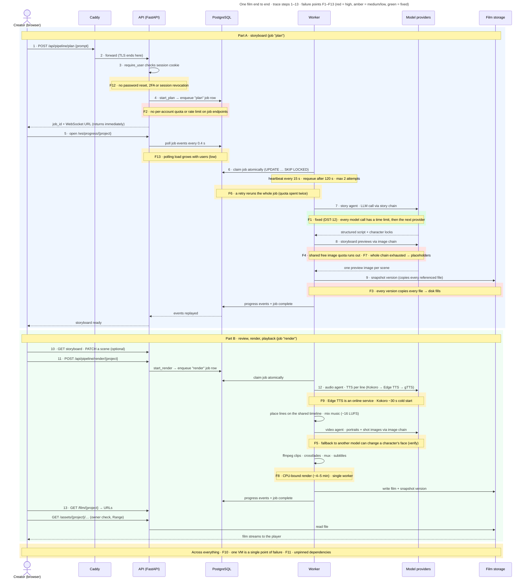

# One film, end to end: request trace and failure points

> **DST-5.** Traced through the code on `main`. Every step names the file and function that handles it. Failure points marked *(verify)* still need to be reproduced before they're treated as confirmed.

**Example request:** a signed-in creator types *"A clockmaker in a flooded city repairs the hours people lose"*, reviews the storyboard, approves it, and watches the film.

---

## Diagram

Steps 1–13 match the trace table below. Failure points sit where they happen (red = high severity, amber = medium or low, green = fixed).

---

## 1. The trace

### Part A: storyboard (job `plan`)

| # | Step | Where in the code |
|---|---|---|
| 1 | The browser sends `POST /api/pipeline/plan` with the prompt | `web/lib/api.ts` → `plan()` |
| 2 | Caddy terminates TLS and forwards the request to the API container | `deploy/Caddyfile` → `reverse_proxy api:8000` |
| 3 | The router-level dependency checks the session cookie before any route runs | `backend/app.py` (`_signed_in`) → `auth/deps.py` `require_user` |
| 4 | `start_plan` records the project's owner, **writes a `plan` job row**, and returns `job_id` and the WebSocket URL immediately | `backend/routes/pipeline.py` `start_plan` → `_accepted()` → `jobs/queue.py` `enqueue()` |
| 5 | The browser opens `/ws/progress/{project_id}`, which authenticates by cookie, checks ownership (`may_access`), sends a snapshot, then polls job events | `backend/websocket/progress.py` → `backend/services/progress.py` `stream()` |
| 6 | A worker **claims the job atomically** (`UPDATE … SKIP LOCKED`) and starts a heartbeat thread (every 15 s) | `jobs/worker.py` `run_forever()` → `queue.claim()` → `run_job()` / `_Heartbeat` |
| 7 | The orchestrator runs the story agent, which makes one LLM call through the `story` provider chain (Groq → OpenRouter → Gemini → Ollama → mock template; Groq first since DST-15) and gets back a structured script. Each character gets an appearance lock and a seed | `agents/orchestrator/workflow.py` `plan()` → `agents/story_agent/` → `mcp/tools/llm_tools/llm_client.py` |
| 8 | One storyboard preview per scene is drawn through the `image` chain (Cloudflare FLUX → Agnes, if a key is set → placeholder) | `mcp/tools/vision_tools/image_gen_tool.py` |
| 9 | The state is **snapshotted** (every referenced file is copied into a new version), a progress event is written, and the job is marked complete | `state_manager/` `snapshot()` → `jobs/queue.py` `complete()` |

### Part B: review, render, playback (job `render`)

| # | Step | Where in the code |
|---|---|---|
| 10 | The creator reads the storyboard (`GET /storyboard/{pid}`) and may edit a scene (`PATCH /storyboard/{pid}/{scene}`) | `backend/routes/pipeline.py` `get_storyboard` / `edit_storyboard` |
| 11 | `POST /render/{pid}` checks that a script exists, then **writes a `render` job row** | `backend/routes/pipeline.py` `start_render` → `_accepted()` |
| 12 | A worker claims the job and runs `render()`: the **audio agent** voices each line (TTS chain: Kokoro → Edge TTS → gTTS → silent, in parallel), places the lines on the **shared timeline**, and mixes music (ducked under speech, −16 LUFS); the **video agent** draws portraits and shots (image chain), renders the clips with ffmpeg, crossfades, muxes and adds subtitles; then **snapshot** | `agents/orchestrator/workflow.py` `render()` → `agents/audio_agent/` → `shared/timeline.py` → `agents/video_agent/` → `mcp/tools/video_tools/ffmpeg_tool.py` → `state_manager/` |
| 13 | The browser calls `GET /film/{pid}` to get the URLs, then `GET /assets/{pid}/…`, which checks ownership, blocks path traversal and supports Range requests so the player can seek | `backend/routes/pipeline.py` `film()` → `backend/app.py` `serve_asset()` |

---

## 2. Already handled

| Risk | How the code handles it |
|---|---|
| Two workers take the same job | The claim is a single atomic `UPDATE`; Postgres skips locked rows (`jobs/queue.py` `claim_statement`) |
| The worker crashes partway through a film | Heartbeats stop; `requeue_stale()` puts the job back after 120 s, at most 2 attempts |
| A job raises an error | `run_job` catches it, `queue.fail()` retries if attempts remain, and the error is shown to the user as an event; the worker keeps running |
| A cancel leaves broken files | Cancel is checked between steps, so no ffmpeg process is killed halfway |
| Someone watches or downloads another user's film | The WebSocket and `/assets` both check ownership and return 404 (not 403); path traversal is blocked |
| Brute-force login | Per-account lockout after repeated failures (`auth/accounts.py`) |
| Cross-site requests | CORS is closed unless origins are named (`backend/app.py`) |
| A stuck ffmpeg clip | Each clip has a timeout (`CLIP_TIMEOUT_S = 900` s) |
| A model provider that never answers (F1, fixed in DST-12) | Every LLM, image and online voice call has a `timeout_s`; when it runs out the call counts as failed and the next provider in the chain takes over at once (details under F1 below) |

---

## 3. Open failure points

| # | Step | What fails | Impact | Handled today | Severity |
|---|---|---|---|---|---|
| **F1** | 7, 12 | **Model calls had no explicit timeout.** The LLM clients (`genai.Client`, `OpenAI`, `Anthropic` in `llm_client.py`) were created with library defaults: OpenAI/Groq waited up to 600 s per attempt and retried twice; Gemini set none, which was verified to mean forever. The heartbeat thread keeps beating meanwhile, so `requeue_stale()` never fires. **Reproduced in the baseline run** (36 min hang, below) | A hung provider left the film "running" for many minutes, or indefinitely, instead of falling through to the next provider | **Yes, DST-12** (see below) | ~~High~~ **Fixed** |
| **F2** | 4, 11 | **No per-account render quota and no rate limit on job endpoints** | One account can flood the queue and use up everyone's free image quota | Login lockout only | **High** |
| **F3** | 9, 12 | **Every version copies every file** | Disk fills up: renders fail and Postgres is at risk on the same VM | Backups hard-link; the live store does not | **High** |
| **F4** | 8, 12 | **The shared free image quota runs out** (Cloudflare: 10k neurons/day) | Every user gets placeholders until the daily reset (Agnes would draw them, but its free tier may train on prompts, so the server has no key by design: docs/PROVIDERS.md) | Falls through the chain at once with no retries, and is named on the job's completion event and trace (DST-20, F15) | **High** |
| **F5** | 8, 12 | **Fallback breaks character consistency.** The seed reproduces a face only on the same model; if the chain moves from Cloudflare to Agnes partway through a film, the same character can come out different *(verify)* | The film's characters change face, the core quality promise | No | Medium |
| **F6** | 6 | **A retry reruns the whole job from the start** | The quota is spent twice for one film; a 5-minute render becomes 10 | By design | Medium |
| **F7** | 7–8, 12 | **The whole chain is exhausted**, so the system falls back to the mock template or placeholder images | The film "succeeds" but looks broken, and the user may not know why | Logged, placeholder drawn | Medium |
| **F8** | 12 | **CPU-bound rendering with a single worker** on the free ARM VM | About 4–5 min per film; the queue wait grows with every user | Per-clip timeout | Medium |
| **F9** | 12 | **Voices:** Edge TTS is an online Microsoft service; Kokoro takes ~30 s to load its model on first use | Voices fail during an outage; the first render after a restart is slow | Falls back to gTTS, then silence | Medium |
| **F10** | all | **Everything runs on one VM** (Postgres, API, worker, Caddy); Oracle may stop an idle free VM | Total outage | Nightly backups, tested restore | Medium |
| **F11** | build | **Unpinned Python dependencies** | A rebuild can break or behave differently | **Yes, DST-16**: `uv.lock` pins every package; CI and the image install from it (see below) | ~~Medium~~ **Fixed**, with gaps |
| **F12** | 3 | **Account gaps:** no password reset, no 2FA, no per-device session revocation, no per-IP rate limit, password rules weaker than the standard | Account security is incomplete: 14 of the 71 ASVS login and session requirements fail, 10 of them at level 1 | **Audited in DST-21** ([SECURITY.md](SECURITY.md)); each failure is a drafted Sprint 2 ticket. Sign-ups closed by default | **High** (was Medium) until the three High tickets land |
| **F13** | 5 | **Progress comes from polling job-event rows** | Database load and lag grow with users | Fine at current scale | Low |
| **F14** | 12 | **Dialogue Kokoro cannot read.** Kokoro reads every line as English (`lang="en-us"`); the story model writes dialogue in the prompt's language, and nothing checked a film's length. **Reproduced in the baseline** (dst-05, below) | A broken film reported as a plain success | **Yes, DST-17** for non-Latin scripts and over-long films (see below) | ~~High~~ **Fixed**, with gaps |
| **F15** | 7–8 | **Retry decisions read the error text by substring.** A used-up daily quota was not told apart from a short rate limit; Cloudflare's daily-quota 429 skipped its retries only because its body contains "400", and the same match would end the retries of a short rate limit that quotes a number like 14400. Nothing recorded why a provider was skipped | Retries that cannot succeed, or a short limit that falls to a weaker provider; no way to see a quota ran out | **Yes, DST-20** (see below) | ~~Medium~~ **Fixed**, with gaps |

### F1 in detail (fixed in DST-12)

**Reproduced in the baseline run.** On 2026-10-28, during the DST-10 baseline
renders (`python scripts/benchmark.py --testset eval/testset.jsonl
--render-subset`, commit `9cedcf7` plus the benchmark harness only), test-set
prompt `dst-07` ("Rain") hung in the `story` call to Gemini
(`gemini-flash-latest`):

| | |
|---|---|
| Call started | 11:29:42.942 PKT (the story agent logged `phase 1 start (provider=gemini)`) |
| Stopped by hand | 12:05:47.232 PKT |
| Stuck for | **2,164 s (36 min 4 s)**, and still waiting |
| Evidence | No log line of any kind after the call; the interpreter used no CPU; an HTTPS connection to a Google-range address (`172.217.114.4:443`) was still open |

Expected: after a bounded wait the call fails and Groq writes the script.
Actual: the run waited until stopped. Inside a worker the heartbeat would have
kept the job looking alive the whole time. Raw record:
`data/benchmarks/20261028_dst07_gemini_hang.json` (not committed; `data/` is
ignored).

**The cause, checked in the installed SDKs** (google-genai 2.33.0, openai
3.40.0, anthropic 2.3.0): google-genai passes `timeout=None` to httpx when no
`HttpOptions.timeout` is set, and httpx then waits forever. The OpenAI and
Anthropic SDKs default to 600 s per attempt plus two retries of their own.

**The fix.** Every provider in `config/providers.yaml` can set `timeout_s`;
without it the role's default from `shared/providers.py` applies:

| Role | Default | Why |
|---|---|---|
| story | 180 s | Gemini scripts that succeeded took 31.5, 83.9, 112.2 and 114.5 s in the baseline run, so 60 s would have cut off three of four |
| edit_intent, translate | 60 s | Short prompts and answers |
| image | 120 s | Cloudflare keeps the 180 s and sd_webui the 300 s they already had, now as `timeout_s` |
| tts | 60 s | ElevenLabs already had 60 s |

- **LLMs:** Gemini gets `HttpOptions(timeout=...)` (in milliseconds). The
  OpenAI-compatible clients (Groq, OpenRouter, Ollama, OpenAI) and Anthropic get
  `timeout=` and `max_retries=0`: the provider chain is the retry, so a failure
  goes straight to the next provider instead of being repeated three times.
- **Images:** every HTTP call uses the provider's `timeout_s`. A timeout ends
  that provider's attempts at once; `retries` still covers quick 429 and 500
  answers (but not a 429 for a used-up daily quota, since DST-20: F15 below).
- **Voices:** edge-tts runs as a subprocess, which is killed after `timeout_s`;
  gTTS (which otherwise waits forever) and ElevenLabs get it as their request
  timeout. Then the next engine speaks.
- A timeout is logged as "no answer within N s", so it reads differently from
  a refusal.

**Worst case now**, if every provider in a chain hangs: a script waits at most
3 × 180 s (Groq, OpenRouter, Gemini) and then uses the template; an image waits
180 s (Cloudflare) plus 120 s (Agnes, only where a key is set) and then gets a placeholder.

**Tests** (`tests/unit/test_model_call_timeouts.py`) use a real local server
that accepts the connection and never answers. The real Gemini adapter, aimed at
it through `GOOGLE_GEMINI_BASE_URL`, falls through to an answering provider in
1 s plus slack, and is asked exactly once; the same holds for the
OpenAI-compatible client, for an image provider (one attempt, not three), and
for a hung edge-tts process. Run against `main`, 25 of the 26 tests fail, the
hung-provider ones with "still waiting after 20 s" (30 s for the image test).
The one that passes on both checks that a slow answer inside the limit is kept.

**Not covered, on purpose or by limitation:**
- Kokoro, pyttsx3 and local Stable Diffusion run inside the process with no
  network, so there is nothing to wait on and no safe way to interrupt them.
- ~~MyMemory, the last step of the translate chain, is called through
  `deep_translator`, which offers no timeout.~~ **Fixed in DST-18**: MyMemory is
  now called directly with the translate role's `timeout_s` (60 s by default),
  a timeout is not retried, each attempt is traced like any other model call,
  and a language that could not be translated is named on the job's completion
  event (`subtitles_skipped`) instead of disappearing silently. Reproduced
  before the fix: pointed at a server that never answers, the old call was
  still waiting after 10 s; now it stops at its limit
  (`tests/unit/test_mymemory_timeout.py`).
- The paid video and lip-sync roles (Veo and others) have never been called and
  were left alone.
- `requests` and httpx limit each wait for data, not the whole call: a server
  that sent one byte every 59 s would not be cut off by a 60 s limit.

### F14 in detail (fixed in DST-17)

**Reproduced in the baseline.** dst-05, a prompt written in Urdu, got Urdu
dialogue, and every line was voiced by Kokoro with English phonemes: espeak
logged "words count mismatch on 100.0% of the lines", and each line came out
6 to 11 times longer than estimated (a 10-word line: 4.5 s estimated, 28.8 s
recorded). The film was 150.8 s for a 30 s target on 2026-10-29 (210.0 s on
2026-10-28) and reported as a success.

**The fix.**
- Each speaker's language is read from the writing system of their lines
  (`shared/languages.py` `spoken_language`). A speaker of Urdu, Arabic, Hindi,
  Japanese, Korean, Chinese or Russian is voiced by Edge TTS in that language,
  with gTTS in that language as its fallback (`AudioAgent.voice_plan`). The
  storyboard names the same voice. Who actually spoke each line is kept on the
  line (`AudioSegment.engine`, `voice`) and in the trace.
- A film more than `FILM_LENGTH_TOLERANCE` (0.5) from its target is flagged on
  the job's completion event (`length_warning`) and in the creator interface
  ("Your film is ready, but it came out 151 s for a 30 s target").
- **Re-run of dst-05 after the fix** (2026-10-29, placeholder images): 21.4 s
  for the 30 s target, all 4 lines by Edge's `ur-PK-AsadNeural`, each within
  its estimate.

**Gaps that remain:**
- Latin-script languages (Spanish, French, Roman Urdu) cannot be told from
  English by their letters, so they stay with Kokoro's English voice. Their
  length stays close to normal, and the length check would catch a bad one.
- Edge has one voice per gender in these languages, so every male speaker of
  a film in Urdu has the same voice; "switch to another voice" fails with a
  clear message for them instead of switching to an English voice.
- Subtitles assume English dialogue: translation always starts from English,
  so a film in Urdu gets an "English" track in Urdu.

### F15 in detail (fixed in DST-20)

**What the baseline logs show.** In the DST-10 renders (2026-10-28 and 29),
Cloudflare refused 41 image calls with HTTP 429, "you have used up your daily
free allocation of 10,000 neurons". Every one was logged as `attempt 1/3` with
no retry. Not on purpose, though: the image tool's `_is_permanent` treated any
error text containing "400" as a rejected request, and Cloudflare's body
carries error code 4006. The same substring match ended the retries of a short
429 that quotes such a number: on `main`, "HTTP 429: Limit 14400, Used 14390"
got one attempt instead of three. Gemini's daily quota
(`429 RESOURCE_EXHAUSTED`) and Groq's tokens-per-minute limit were already
skipped at once, because the language-model chain never retries a provider
that refuses. In none of these cases did the job or its trace say a quota had
run out.

**The fix.**
- `shared/providers.py` `is_daily_quota`: HTTP 429 *and* a message that names a
  daily window. The words each provider uses are listed beside the rule: the
  Cloudflare and Groq ones are taken from the baseline logs, the rest from each
  provider's documented errors. "Today" alone does not count, because Groq's
  per-minute answer ends "Upgrade to Dev Tier today". Any other 429 keeps its
  retries.
- A daily-quota 429 ends that provider's attempts at once, for images and for
  MyMemory (whose refusal now includes the body, so the rule can read it).
- `_is_permanent` decides by the HTTP status (400, 401, 403), not by a
  substring.
- Every model call already passes through `tracing.model_call`. It now marks
  the failed call `daily_quota: true` and notes `role:provider` for the job.
  The completion event of a plan, render, re-run or edit lists them
  (`daily_quota_used_up: ["image:cloudflare"]`) and says so in its message.
- Tests: `tests/unit/test_daily_quota.py`, 30 tests. Run against `main`'s code
  (with stand-in names so it imports), 16 fail. The 14 that pass are the cases
  whose behaviour was meant to stay the same.

**Gaps that remain:**
- Once a daily quota runs out, each later image still asks that provider once
  (and fails fast) before falling through. Skipping it for the rest of the job
  or the day would save that call; it was left out of this ticket.
- A MyMemory quota warning that arrives as the "translation" in a successful
  answer was already not retried, but it is not counted on the event, because
  there is no 429 to read.
- Gemini's per-day quota id, and the OpenRouter and MyMemory messages, follow
  the providers' documented formats; only Cloudflare's and Groq's words were
  captured here.

### F11 in detail (fixed in DST-16)

**What was wrong.** Six `requirements*.txt` files declared 33 direct
dependencies, 32 of them as ranges (`>=2.0`); only `langfuse==5.0.4` was exact,
and nothing pinned the packages those pull in. Every build resolved afresh.
Measured on 2026-10-30: a fresh resolution differed from the maintainer's
laptop environment in 14 of the 98 packages both held (`numpy` 2.4.6 → 2.5.4,
`openai` 3.40.0 → 3.41.0, `google-genai` 2.33.0 → 2.34.0, `pydantic` 2.14.1 →
2.14.2, and others). The laptop, CI and the image were three different sets of
versions, and the last two changed whenever a package published a release.

**The fix.**
- `pyproject.toml` lists the direct dependencies once: 20 core, 5 in four
  extras (`postgres`, `s3`, `voices`, `tracing`) and 5 for the tests (`dev`,
  which includes `moto`, until now named only on CI's install line).
- `uv.lock` pins 277 packages, with 1,368 file hashes that uv checks on
  install, for Windows, Linux and macOS, x86 and ARM, Python 3.11 and 3.12 at
  once.
- CI (`uv sync --locked`) and the image build (`uv sync --locked` with the
  `postgres`, `voices` and `s3` extras and the test tools, as before) install
  exactly that, and fail when `pyproject.toml` and `uv.lock` disagree. The
  requirements files are deleted, so there is one source. How to install, add
  and upgrade is in [DEVELOPMENT.md](DEVELOPMENT.md#dependencies).
- uv itself is pinned (0.13.6 in the Dockerfile and the workflow, and
  `astral-sh/setup-uv@v10.3.3`).

**Checked on 2026-10-30:**
- Two clean installs from the lock gave 112 packages each, with identical lists
  (same checksum), and `uv sync --dry-run` on the result says "Would make no
  changes".
- Every locked package has a wheel for Debian 12 on aarch64 (the VM), Linux
  x86_64 on Python 3.11 and 3.12, and Windows (`uv pip compile --only-binary
  :all:` per platform). The same check fails for a package that ships no
  wheels, shown with a control, so it can fail.
- Changing `pyproject.toml` without the lock makes both `uv lock --check` and
  `uv sync --locked` fail.

**Gaps that remain:**
- The lock is the newest versions on the day it was written, not what the VM
  runs today: the VM's next deploy moves versions once (14 packages differed
  from the laptop; the VM's own set was not measured).
- A pinned lock does not update itself. Upgrades are manual (`uv lock
  --upgrade`), and no scheduled update or vulnerability check exists yet.
- Local Stable Diffusion (torch, diffusers) is outside the lock on purpose: it
  would add 45 packages and a torch that is not the CUDA build GPU users need.
  Its install commands are in DEVELOPMENT.md.
- GitHub Actions are pinned by tag, not by commit. The base images
  (`python:3.11-slim`, `node:22-slim`) and apt packages still float.
- CI builds the image for x86 only. The aarch64 image was checked for wheels,
  not built; the build on the VM is the check.

### F12 in detail (audited in DST-21)

**What was checked.** How people sign in, sign up and hold a session, against
OWASP ASVS 4.0.3 chapters 2 and 3 at levels 1 and 2 (71 requirements), by
reading the code and probing a throwaway local instance on 2026-10-30. Audit
only; no code changed. The full result, with the file, function, test or probe
behind every verdict, is in [SECURITY.md](SECURITY.md).

**Result:** 25 pass, 14 fail, 28 not applicable, 4 not assessed (service
authentication). At level 1 alone: 21 pass, 10 fail, 8 not applicable.

**What is solid:** argon2id with a unique salt; 256-bit random session tokens
stored only as a digest; an `HttpOnly`, `SameSite=Lax` cookie that is `Secure`
in production; a new token at every sign-in; sign-out, password change and
disabling an account end sessions at once.

**What fails, most important first:**
- No per-IP limit on sign-in or sign-up, and anyone can lock a known account
  for 15 minutes (2.2.1). 40 failed logins for 40 emails were all answered in
  3.0 s.
- Password rules below the standard: 10 characters where it asks for 12,
  1,024 where it asks for at most 128, no breached-password check (2.1.1,
  2.1.2, 2.1.7).
- A locked or disabled account answers differently from a wrong password, and
  5 times faster (14 and 15 ms against 70 ms), so the earlier claim of identical
  answers held only for active, unlocked accounts. Corrected in the root
  SECURITY.md.
- No email at all: no reset, no notices, no verification (2.2.3, 2.5.5, 2.5.6).
- Sessions cannot be ended one by one (3.3.4), have no idle limit at level 2
  (3.3.2), and the cookie has no `__Host-` prefix (3.4.4).
- No CSRF token or `Origin` check (4.2.2, 13.2.3); `SameSite=Lax`, JSON-only
  bodies and no CORS are the protection today.

**Tickets:** 14 drafted for Sprint 2 (30 points), in section 7 of SECURITY.md.
The three High ones (rate limiting, indistinguishable failures, password rules)
are 7 points.

**Gaps that remain in the audit itself:**
- Probes ran once, on one instance, and the sign-in page was read, not driven
  in a browser.
- Service authentication (V2.10: how the server logs in to Postgres and third
  parties) was not assessed.
- ASVS 5.0, which renumbers these chapters, was not mapped.

---

## 4. Fix first

1. ~~**F1: add a timeout to every model call**, and let a timeout fall through to the next provider.~~ **Done in DST-12** (above).
2. **F2: per-account render quotas and rate limiting.** Already on the Week 1 track.
3. **F3: content-addressed storage for versions.** Store each file once, by hash. Already on the Week 1 track; measure storage growth before and after.

*F4 and F5 move into the Week 2 work on self-hosted images and the consistency check.*
